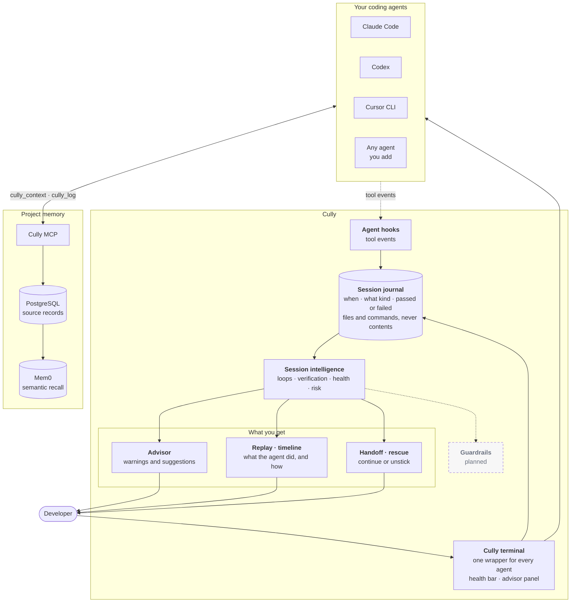

# How Cully works

Cully Solo is the coding-agent harness runtime. It runs the coding agents you already use in one terminal, observes their tool activity, tracks session health, remembers what matters and helps you recover or continue. Each agent keeps its own reasoning and tools.

> **Session intelligence. Private memory. A better harness.**
> Work across agents, keep useful context, and improve the harness from measured evidence.

[Solo](/solo) describes one developer's local setup. IC describes an individual contributor using shared services with private, authenticated memory. These are usage descriptions, not mode flags. Existing [Team workflows](/team-workflows) manage explicitly authorized project tasks, handoffs and review separately from private memory. The diagram below shows the runtime shared by Solo and IC.

| Step | What happens | What does it today |
| --- | --- | --- |
| Observe | Tool activity from the agent becomes events | The [Cully terminal](/terminal) and agent hooks |
| Understand | Events become a picture of the session | The [session journal](/session-intelligence) |
| Remember | Decisions and results outlive the session | [Private memory](/memory) |
| Advise | Warnings and next steps appear while you work | The [advisor](/advisor) |
| Evaluate | Test the harness and guidance against known failures | [Cully evaluations](/evals) and task measurements |
| Improve | Review a proposed change and inspect what happens afterward | [Self-improvement](/self-improvement), [harness audit](/harness) and [token impact](/token-impact) |

## The picture



Solid boxes ship today. The dashed box is planned and described in [product direction](/product-direction).

Two arrows matter most:

- **Traffic never goes through Cully.** Your agent talks to its model and tools directly. The Cully terminal only draws around the agent, and hooks send small events to the journal.
- **Memory is separate from the session.** The agent saves and finds notes through its own MCP connection. Cully's local parts do not hold your agent's sign-in.

## One terminal for every agent

```sh
cully run claude        # Claude Code
cully run codex         # Codex
cully run cursor        # Cursor CLI (cursor-agent)
cully run my-agent      # any other agent on your PATH
```

Every agent runs in the same wrapper with the same health bar and advisor panel. See [the Cully terminal](/terminal).

## What stays private

The journal keeps coarse facts: time, agent, kind of tool, pass or fail, project-relative file paths with the operation, and the program and recognized subcommand of a command. It never keeps prompts, file contents, command arguments or tool output. See [privacy](/privacy).

## Read next

| If you want to | Read |
| --- | --- |
| See the terminal and health bar | [The Cully terminal](/terminal) |
| Understand loops, replay, handoff and rescue | [Session intelligence](/session-intelligence) |
| Know exactly what is built and what is planned | [Current capabilities](/capabilities) |
| See where Cully is heading | [Product direction](/product-direction) |
